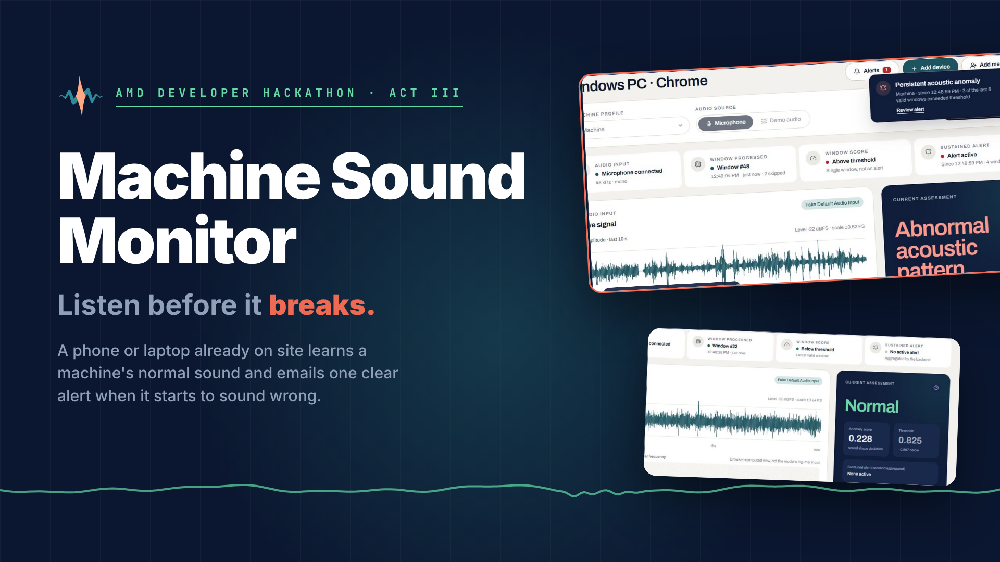
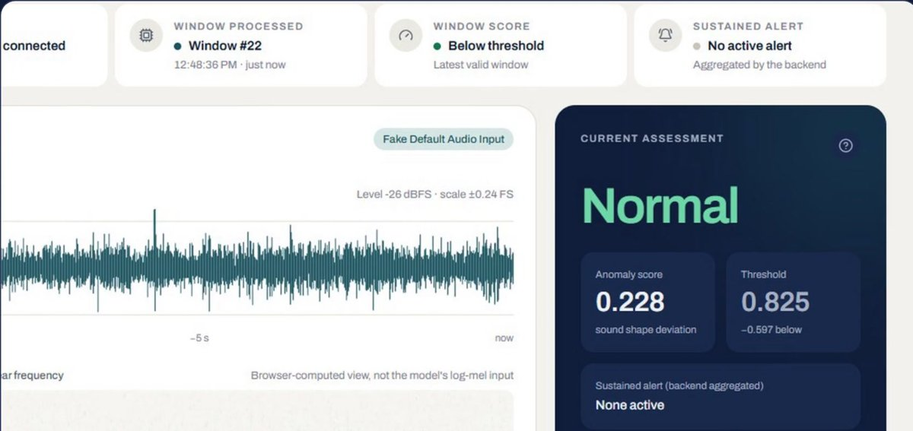
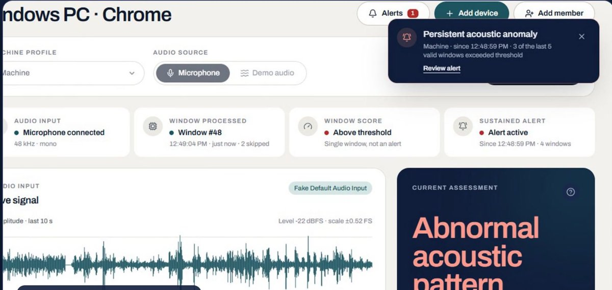
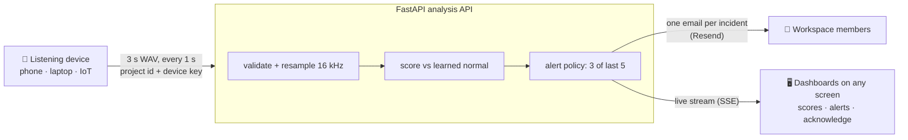
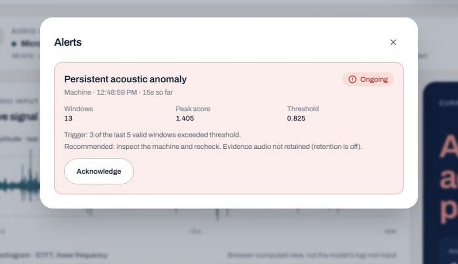

<div align="center">



# Machine Sound Monitor

**Listen before it breaks.**

A phone or laptop already on site learns a machine's own normal sound,<br>
and emails the team one clear alert when the machine starts to sound wrong.


[**▶ Pitch video (2:06)**](media/pitch-video-2min.mp4) · [**Slides (PDF)**](media/pitch-deck.pdf) · [28 s ad](media/pitch-ad.mp4) · [Long demo (2:38)](media/pitch-video.mp4)

</div>

---

## The problem

Machines rarely fail in silence. Weeks before a fan, pump or motor breaks, it starts to **sound different**. But a
maintenance team can't stand next to every machine, so the change is usually noticed only when it is loud enough to
bother someone. By then it means **downtime and an expensive repair**.

```text
Sound starts to change ──────── weeks of warning, unheard ──────── Someone notices ──── Failure
```

## The solution

Machine Sound Monitor turns a device that is **already on site** into a listener. No special hardware.

| | |
| --- | --- |
| 📱 **Phone or laptop browser** | Works today: open the listener link, allow the microphone. |
| 📡 **IoT device with a sound sensor** | Posts its audio windows to the same API with its own device key. |
| 🧠 **Learns this machine** | About a minute of normal sound, then locked in until someone asks it to re-learn. |
| 🔔 **One clear alert** | An email to the workspace members, live on every dashboard, acknowledged by a person. |

<table>
<tr>
<td width="50%"><br><sub><b>Normal:</b> every window under the line</sub></td>
<td width="50%"><br><sub><b>The fan develops a rattle:</b> abnormal windows, then one alert</sub></td>
</tr>
</table>

## How it works

| 1 · Listen | 2 · Compare | 3 · Ignore one-offs | 4 · One alert |
| --- | --- | --- | --- |
| A **3 s window every second**, resampled to 16 kHz. | Sound **character** against the learned normal, not volume. A level change is a note, never an anomaly. | A door slam is one window. An alert needs **3 of the last 5** valid windows. | One event per incident, quiet until it recovers, then a **30 s cooldown**. |





Each alert records **when it started, how many windows triggered it, the peak score and the threshold**, and
recommends that a person inspects the machine and rechecks. Anyone on the dashboard can acknowledge it.

**Built for real rooms:**

- 🤷 Says **"Unable to assess"** when the signal is too weak, instead of guessing.
- 🔇 **Raw audio is never stored.** Only scores and events are kept.
- 🔑 Device and viewer keys are shown once and stored as **SHA-256 hashes**.
- 🩺 An **early warning** that asks a person to check. Not a diagnosis.

<br clear="right">

## Results

### On a real machine (live demo scorer)

A phone recording of a desk fan, then the same fan with a rattle. The on-site scorer learned that fan's normal minute.

| Recording | Anomaly score | |
| --- | --- | --- |
| Normal fan | **0.23 – 0.49** | 🟩 under the line |
| Fan with a defect | **0.85 – 2.36** | 🟥 over the line |
| Learned alert line | **≈ 0.9** | from how much the learned minute itself varied |

### On the DCASE 2020 benchmark (trained models)

Held-out test split of the DCASE 2020 Task 2 **fan** data, trained on healthy audio only
([report](ml/reports/eval-20261017-055600.md)).

| Model | ROC AUC |
| --- | --- |
| Dense autoencoder (ours, DCASE baseline shape) | **0.646** |
| PANNs CNN14 embedding + kNN (frozen, pretrained) | 0.594 |
| Conv autoencoder (ours) | 0.503 |
| Official DCASE 2020 baseline (fan) | ≈ 0.66 |

## How we built it

| Layer | Stack |
| --- | --- |
| **Listener + dashboard** · [`frontend/`](frontend/) | React 19, TypeScript, Vite, Tailwind CSS, Web Audio API (records 3 s WAV windows in the browser), Supabase sign-in |
| **Analysis API** · [`backend/`](backend/) | FastAPI, NumPy/SciPy resampling, alert policy, Server-Sent Events, SQLite or Postgres (Supabase), email via Resend |
| **Models** · [`ml/`](ml/) | PyTorch autoencoders on log-mel features (one shared feature implementation for training and serving), threshold calibration, DCASE metrics, alert simulation |
| **AMD** · [`ml/run_amd.sh`](ml/run_amd.sh) | Training + evaluation pipeline packaged for **AMD Instinct MI300X** on AMD Developer Cloud, PyTorch on **ROCm**. Reports record the GPU and ROCm version. |

**Three scorers, one interface** (`SCORER=`):

| Scorer | What it is |
| --- | --- |
| `heuristic` (default, used in the demo) | On-site learner: band-energy **shape** against the learned minute. Not a trained model, and labelled as such. |
| `autoencoder` | The trained PyTorch checkpoint from `python -m ml.train`. |
| `embedding` | Experimental: frozen PANNs CNN14 + nearest-neighbour distance to an enrolled healthy profile. |

## Status

| Part | State |
| --- | --- |
| Frontend: landing `/`, console `/app` | ✅ Guest workspaces, devices, members (view / edit), mock, device and watcher modes |
| Backend: FastAPI | ✅ Device keys, alert policy, email alerts, acknowledge, live stream |
| Scoring | ✅ On-site learner by default · `SCORER=autoencoder` serves a trained checkpoint |
| ML pipeline | ✅ Dense + conv AE training, calibration, DCASE metrics, alert simulation |
| AMD training / evaluation | ⏳ **Pending the real run** on the MI300X: follow [`docs/AMD_AI_GUIDE.md`](docs/AMD_AI_GUIDE.md). Results so far are from a Tesla T4. |

## Run it

```bash
# Frontend only, fully simulated (no backend needed)
cd frontend && npm install && npm run dev            # http://localhost:5173

# Real flow: backend + frontend in live mode
cd backend && pip install -r requirements.txt && uvicorn app.main:app --port 8000 --env-file .env
python -m app.admin create-project plant-a "Plant A"         # → dashboard link
python -m app.admin add-device plant-a "Phone at fan"        # → listener link
cd frontend && VITE_MOCK_API=false VITE_API_BASE_URL=http://localhost:8000 npm run dev
```

Open the **listener link** on the device next to the machine and the **dashboard link** on any other screen. See
[`backend/README.md`](backend/README.md) for scorers, settings and the API reference.

<details>
<summary><b>Demo without a backend</b></summary>

In `/app` with mock mode, choose **Demo audio**, press **Start monitoring**, then switch the **Simulation scenario**:
normal, transient spike (no alert), sustained anomaly (exactly one alert), silence (`Unable to assess`), slow backend
(windows skipped), backend offline (`Monitoring interrupted`), microphone denied.

</details>

<details>
<summary><b>Train on AMD</b></summary>

Step by step in [`docs/AMD_AI_GUIDE.md`](docs/AMD_AI_GUIDE.md): create an MI300X GPU droplet on AMD Developer Cloud
(PyTorch image), run `ml/run_amd.sh`, collect `ml/reports/train-*.json` (GPU name, ROCm/HIP version, training time),
then serve with `SCORER=autoencoder MODEL_PATH=<checkpoint>`.

</details>

## Tests

**128 automated tests:** 80 backend · 33 frontend unit · 15 end-to-end (Playwright).

| Command | Covers |
| --- | --- |
| `cd backend && pytest` | WAV validation and resampling, quality gate, scorers, alert policy, auth, idempotency, notify-once, email delivery, no raw audio stored, train → evaluate → serve smoke test |
| `cd frontend && npm test` | WAV encoder, ring buffer, FFT, mock alert policy and scenarios, session reducer, assessment rendering |
| `cd frontend && npm run e2e` | Landing fits the first screen at 5 sizes, mobile overflow, reduced motion, mock console scenarios |
| `cd frontend && npm run e2e:live` | Real backend: a device streams via the mic, a second screen watches the same session, stop → stale |

## Hosting

| Option | What |
| --- | --- |
| **Vercel + Render** | Frontend on Vercel (root `frontend`, `vercel.json`); API as a Docker web service from [`render.yaml`](render.yaml). |
| **Hugging Face Space** | Whole app on one HTTPS URL with [`deploy/hf_space.py`](deploy/hf_space.py) (CPU). |
| **AMD GPU machine** | `uvicorn app.main:app --host 0.0.0.0 --port 8000` behind HTTPS, e.g. `cloudflared tunnel --url http://localhost:8000`. |

Build the frontend with `VITE_MOCK_API=false` and `VITE_API_BASE_URL=<api https url>`, and set the API's
`CORS_ORIGINS` and `PUBLIC_APP_URL` to the frontend URL. Browsers only allow the microphone on HTTPS pages.

## Repository map

```text
frontend/          React app: landing page, console, phone listener
backend/           FastAPI analysis API, scorers, alert policy, email, live stream
ml/                training, evaluation, DCASE metrics, AMD run script, reports/
deploy/            single-container build and Hugging Face Space deploy
docs/              project plan, design brief, ML status, AMD guide, email templates
media/             pitch videos, slides, cover image, screenshots
```

## Roadmap

- Train and serve the model on **AMD Instinct MI300X**.
- A small always-on **IoT listener client** for continuous capture.
- **Per-machine trained models**, from each site's own healthy audio.
- A **fleet view** across many machines.

---

<div align="center">
<sub>Experimental prototype for the AMD Developer Hackathon: ACT III. An early warning for a person to check, not a certified safety or diagnostic system.</sub>
</div>
